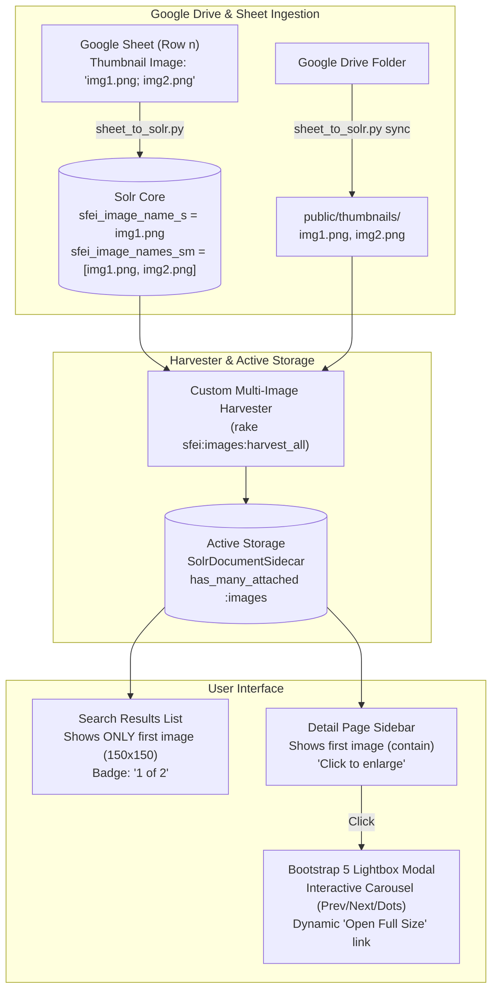

# Technical Specification: Multiple Images Support & Lightbox Carousel

**Feature Reference:** Multiple Images per Dataset with Carousel Lightbox  
**Related Spec:** [`sidecar-images-spec.md`](file:///Users/peter.j.speltz/peter/sfei/SFEI-GeoBlacklight-Internal/docs/specs/sidecar-images-spec.md)  
**Target Branch:** `feature/multiple-dataset-images`  
**Date:** November 2026  
**Status:** Draft / Ready for Team Review  

---

## 1. Overview & Goals

The team requested:
> *"If possible make the plugin support multiple images for a single dataset (in the search show just the first one, but when you click to enlarge allow for clicking through the carousel)"*

This specification defines the end-to-end architecture, metadata schema, ingestion pipeline, Active Storage model design, and UI components needed to support multiple images per dataset across SFEI's GeoBlacklight internal application.

### Key Requirements
1. **Google Sheet & Solr Schema:** Allow data curators to specify one or more image filenames for a dataset.
2. **Automated Ingestion & Sync:** Download and sync all referenced images from Google Drive to `public/thumbnails/` via `sheet_to_solr.py`.
3. **Search Results Page:** Maintain clean layout alignment by showing only the **first (primary) image** (150px × 150px square thumbnail), optionally with a discreet multi-image badge indicator (e.g. `1/3`).
4. **Show / Detail Page Sidebar:** Display the primary thumbnail at the top of the right sidebar with a "Click to enlarge" prompt.
5. **Enlarged Lightbox Carousel:** Clicking the thumbnail opens a native Bootstrap 5 modal containing an interactive carousel allowing users to cycle through all attached images with keyboard arrows, touch swipe, and prev/next controls.
6. **"Open Full Size" Link:** Header button dynamically updates to link directly to the unscaled, full-resolution Active Storage blob of the currently viewed image in a new tab.
7. **100% Backward Compatibility:** Single-image records and records without images must continue to function with zero visual or behavioral regressions.

---

## 2. Key Architecture & Assumptions

### 2.1 Metadata & Delimiter Format in Google Sheet
* **Assumption:** Curators will continue using the existing **"Thumbnail Image"** column in the Google Sheet.
* **Delimiter:** Multiple filenames will be separated by a semicolon `;` (standard across all multi-valued fields in GeoBlacklight / Aardvark) or commas `,`. Whitespace around filenames is stripped automatically.
  * Example cell value: `BHM2020v13.png; BHM2020v13_transects.png; BHM2020v13_legend.png`
* **Order Preservation:** The order listed in the cell establishes the display order in the carousel:
  * Index `0` (first image) is always treated as the **primary thumbnail** for search result cards and the initial sidebar preview.
  * Subsequent images appear as slides 2, 3, etc. in the lightbox carousel.

### 2.2 Solr Field Strategy: Dual Indexing for Safety
To guarantee that existing code and upstream gem assumptions do not break:
1. **`sfei_image_name_s` (Single-string):** Stores the **first filename** only. This preserves backward compatibility with any queries or components expecting a single string.
2. **`sfei_image_names_sm` (Multi-valued string array):** Stores the complete ordered list of all filenames `["BHM2020v13.png", "BHM2020v13_transects.png", "BHM2020v13_legend.png"]`.
   * *Solr Schema Note:* Solr's `schema.xml` already includes `<dynamicField name="*_sm" type="string" stored="true" indexed="true" multiValued="true" />`. Therefore, **no Solr schema changes or re-core definitions are required.**

### 2.3 Active Storage & Sidecar Architecture
The upstream `geoblacklight_sidecar_images` gem natively defines `has_one_attached :image` on `SolrDocumentSidecar`.
* Rather than forking or modifying the vendor gem source, we extend `SolrDocumentSidecar` via `config/initializers/geoblacklight_sidecar_images.rb` (or an `app/models/solr_document_sidecar.rb` decorator) with:
  ```ruby
  SolrDocumentSidecar.class_eval do
    has_many_attached :images
  end
  ```
* Active Storage's standard schema (`active_storage_attachments`, `active_storage_blobs`) natively supports multiple attachments on any record via `name: "images"`. **No database schema migration is required.**
* **Primary Image Resolution:**
  * For backward compatibility, `sidecar.image` remains attached to image #1 (or `sidecar.primary_image` falls back to `sidecar.images.first`).
  * `sidecar.all_images` returns `sidecar.images.attached? ? sidecar.images : (sidecar.image.attached? ? [sidecar.image] : [])`.

---

## 3. Data Flow Diagram



---

## 4. Component & UI/UX Specification

### 4.1 Search Results (`SearchResultComponent`)
* **Visual Presentation:** Displays only the first image in the 150×150 square thumbnail slot on the left.
* **Multi-Image Indicator (Subtle Badge):**
  * When `document.sidecar.all_images.count > 1`, render a compact semi-transparent badge in the bottom-right corner of the thumbnail:
    ```html
    <span class="badge bg-dark bg-opacity-75 position-absolute bottom-0 end-0 m-1 px-1 py-0" style="font-size: 0.7rem;">
      <svg ...></svg> 3
    </span>
    ```
  * Hovering displays a tooltip: *"3 images available — click to view dataset"*.
* **Zero Visual Disruption:** The grid and row sizing remain identical to the existing single-image layout.

### 4.2 Detail Page Sidebar (`DocumentSidebarComponent`)
* **Sidebar Card:** Displays the primary thumbnail (`max-height: 250px`, `object-fit: contain`).
* **Enlarge Callout:** 
  * If single image: *"Click to enlarge"*
  * If multiple images: *"Click to enlarge (3 images)"* or icon badge.
* Clicking anywhere on the card or thumbnail triggers `#sidebar-image-lightbox-#{document.id}`.

### 4.3 Lightbox Modal Carousel
When opened, the modal displays:
1. **Modal Header:**
   * Document title (truncated with ellipsis if long).
   * **Slide Counter:** e.g., `<span class="badge bg-secondary me-2" id="carousel-counter">Image 1 of 3</span>`.
   * **"Open full size" Button:** Links directly to the unscaled Active Storage blob URL with `target="_blank"`.
   * Close button (`btn-close`).
2. **Modal Body:**
   * Bootstrap 5 Carousel (`class="carousel slide" data-bs-interval="false"` — manual control only, no auto-play).
   * Responsive container with `max-height: 80vh`, `bg-dark`, centered alignment.
   * `carousel-inner`:
     * Each `carousel-item` contains an `image_tag` styled with `max-height: 75vh; max-width: 100%; object-fit: contain; margin: 0 auto;`.
     * Active item gets `.active`.
   * **Controls (Only shown if `images.count > 1`):**
     * `carousel-control-prev` and `carousel-control-next` arrow buttons.
     * Bottom thumbnail strip or dot indicators (`carousel-indicators`).
3. **Interactive Script (Stimulus or Vanilla JS):**
   * Listens to `slide.bs.carousel` / `slid.bs.carousel` events on the modal.
   * Dynamically updates the header's **"Open full size"** link `href` attribute so it always points to the blob URL of the active slide.
   * Updates the slide counter text ("Image X of Y").
   * Enables keyboard navigation (Left Arrow = Prev, Right Arrow = Next).

---

## 5. Ingestion & Harvester Details

### 5.1 Python Ingestion (`scripts/sheet_to_solr.py`)
Enhance the record processing and image sync routines:
1. **Column Parsing:**
   ```python
   raw_images = row[index] # e.g. "map.png; detail.png"
   image_list = [clean(img) for img in re.split(r"[;,]", raw_images) if clean(img)]
   if image_list:
       doc["sfei_image_name_s"] = image_list[0]         # First image for legacy/single
       doc["sfei_image_names_sm"] = image_list          # Full list for carousel
   ```
2. **Thumbnail Sync:**
   * Collect all filenames across all records in `doc.get("sfei_image_names_sm", [])`.
   * Ensure `sync_thumbnails(...)` verifies and downloads all files in the array from Google Drive to `public/thumbnails/`.

### 5.2 Rails Multi-Image Harvester Task
Extend the harvesting logic with a dedicated rake task `rake sfei:images:harvest_all`:
1. Find or create `SolrDocumentSidecar` for each Solr record.
2. Read `document['sfei_image_names_sm']` (fallback to `document['sfei_image_name_s']`).
3. For each filename:
   * Verify file presence in `public/thumbnails/<filename>`.
   * Check if already attached in `sidecar.images` (by comparing existing blob filenames to avoid redundant re-attachments).
   * If missing from attachments, attach using `sidecar.images.attach(...)`.
4. Trigger variant prewarming for all attached images (`300x300` for list, `400x400` for sidebar, `1200x1200` for carousel).

---

## 6. Open Questions & Alignment Points for Peter

Before implementation begins, consider these design choices:

1. **Google Sheet Formatting:**
   * Is a semicolon-delimited string (e.g. `img1.png; img2.png`) in the current "Thumbnail Image" column acceptable, or does the team prefer a separate column (e.g. "Additional Images")?
   * *Recommendation:* Semicolon in the existing column keeps all image references together and allows simple reordering.
2. **Carousel Indicators Style:**
   * Should the carousel use classic Bootstrap pill/dot indicators, or small thumbnail previews along the bottom?
   * *Recommendation:* Start with dot indicators + "Image X of Y" counter for minimal visual clutter and fast loading; thumbnail strips can be added later if needed.
3. **Image Captions / Titles:**
   * Does the team want custom captions for each secondary image (e.g., "Figure 1: Coyote Creek watershed overview"), or is displaying the dataset title + image counter sufficient?
   * *Assumption for MVP:* Display dataset title + image filename / index; add custom caption support if SFEI creates metadata columns for captions.
4. **Re-harvesting & Deletion Policy:**
   * If an image is removed from the Google Sheet list, should re-harvesting purge the existing Active Storage attachments and re-attach the updated list?
   * *Recommendation:* If the list of filenames changes, purge old attachments and re-attach to ensure the carousel strictly reflects the Google Sheet.

---

## 7. Step-by-Step Implementation Roadmap

- [ ] **Phase 1: Ingestion Script Updates**
  - [ ] Update `scripts/sheet_to_solr.py` to parse delimited strings into `sfei_image_names_sm` and `sfei_image_name_s`.
  - [ ] Update `sync_thumbnails` to collect and download all filenames from multi-valued lists.
- [ ] **Phase 2: Model & Initializer Extensions**
  - [ ] Add `has_many_attached :images` to `SolrDocumentSidecar`.
  - [ ] Add helper methods `all_images` and `primary_image` to `SolrDocumentSidecar`.
  - [ ] Update variant prewarming hook to process all attached images.
- [ ] **Phase 3: Multi-Image Harvester Task**
  - [ ] Create `lib/tasks/sfei_images.rake` with `rake sfei:images:harvest_all` supporting multiple attachments.
- [ ] **Phase 4: UI & Component Updates**
  - [ ] Update `SearchResultComponent` to show primary image + multi-image count badge.
  - [ ] Update `DocumentSidebarComponent` to render the Bootstrap 5 Carousel modal lightbox.
  - [ ] Add JavaScript listener to update the "Open full size" link on carousel slide events.
- [ ] **Phase 5: Automated Testing & Verification**
  - [ ] Add unit tests in `test/models/solr_document_sidecar_test.rb` for multiple image attachments and order preservation.
  - [ ] Verify keyboard and arrow navigation across multiple images in browser.
  - [ ] Verify single-image records render without carousel arrows or controls.
