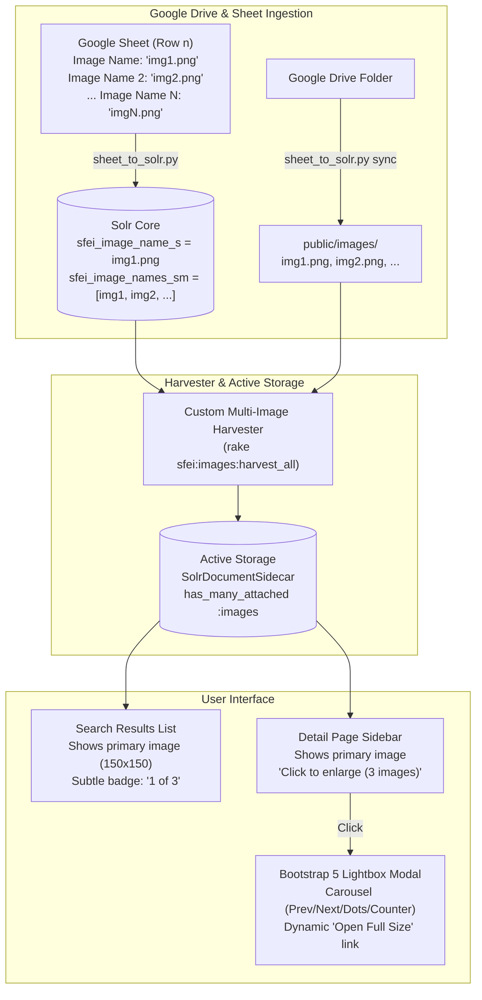

# Technical Specification: Multiple Images Support & Lightbox Carousel

**Feature Reference:** Multiple Images per Dataset with Carousel Lightbox  
**GitHub Issue:** [#14](https://github.com/noorsheikh2/SFEI-GeoBlacklight-Internal/issues/14)  
**Related Spec:** [`sidecar-images-spec.md`](file:///Users/peter.j.speltz/peter/sfei/SFEI-GeoBlacklight-Internal/docs/specs/sidecar-images-spec.md)  
**Target Branch:** `feature/multiple-dataset-images`  
**Date:** November 2026  
**Status:** Approved Architecture / Ready for Implementation  

---

## 1. Overview & Goals

This specification defines the end-to-end architecture, metadata schema, ingestion pipeline, Active Storage model design, and UI components needed to support multiple images per dataset across SFEI's GeoBlacklight application.

### Key Requirements
1. **Dynamic Google Sheet Image Columns:** Curators can specify any number of images using columns named `Image Name`, `Image Name 2`, `Image Name 3`, etc. The pipeline dynamically processes all image columns present without a hardcoded upper limit.
2. **First Image as Primary Thumbnail:** The first image (`Image Name`) serves as the primary thumbnail across search results and the initial sidebar preview.
3. **Asset Directory Refactoring (`public/images/`):** Raw full-resolution images downloaded from Google Drive reside in `public/images/`. Active Storage creates and caches the actual scaled thumbnails in `storage/`.
4. **Automated Ingestion & Sync:** Download and sync all referenced images from Google Drive directly to `public/images/` via `sheet_to_solr.py`.
5. **Search Results Page:** Maintain clean layout alignment by showing only the **first (primary) image** (150px × 150px square thumbnail), with a subtle multi-image count badge indicator (e.g. camera icon or `1/3`) in the corner when multiple images exist.
6. **Show / Detail Page Sidebar:** Display the primary thumbnail at the top of the right sidebar with a "Click to enlarge" callout reflecting total image count (e.g., `Click to enlarge (3 images)`).
7. **Enlarged Lightbox Carousel:** Clicking the thumbnail opens a native Bootstrap 5 modal containing an interactive carousel allowing users to cycle through all attached images with:
   - Next / Previous arrow buttons
   - Slide counter badge (e.g., `Image 2 of 4`)
   - Dot indicators at the bottom
   - Keyboard arrow keys (Left / Right)
8. **Dynamic "Open Full Size" Link:** Header button dynamically updates on slide transition to link directly to the unscaled, full-resolution Active Storage blob of the currently viewed image in a new tab.
9. **Attachment Re-Sync Behavior:** Re-harvesting automatically replaces attachments if sheet columns change, ensuring the carousel matches the sheet columns exactly.
10. **100% Backward Compatibility:** Single-image records and records without images continue to function with zero visual or behavioral regressions.

---

## 2. Architecture & Data Flow



---

## 3. Metadata & Solr Schema

### 3.1 Google Sheet Column Definitions
* **Primary Column (Image 1):** Header `Image Name` in Row 1. (Row 2 Solr field: `sfei_image_name_s`).
* **Secondary Columns (Images 2..N):**
  - Row 1: `Image Name 2`, `Image Name 3`, `Image Name 4`, etc.
  - Row 2: Can be left blank (or populated with `sfei_image_names_sm`). The script automatically detects columns by their Row 1 header matching `r"^image\s*name(?:\s*(\d+))?$"`.
* **Dynamic Ordering:** Filenames are stripped of surrounding whitespace and invisible characters. The column order (`Image Name`, `Image Name 2`, ...) determines the slide order in the carousel.

### 3.2 Solr Field Strategy
Solr only stores two fields for image metadata:
1. **`sfei_image_name_s` (Single-valued String):**
   - Holds the primary filename from `Image Name` (index 0).
   - Guarantees backward compatibility with existing queries and fallback behaviors.
2. **`sfei_image_names_sm` (Multi-valued String Array):**
   - Holds the full ordered list of all populated image filenames for the record: e.g. `["BHM2020v13.png", "BHM2020v13_transects.png"]`.
   - Solr's `schema.xml` natively supports `<dynamicField name="*_sm" type="string" stored="true" indexed="true" multiValued="true" />`.
   - **Zero Solr schema changes or Solr core reloads are required.**

---

## 4. Ingestion Pipeline (`scripts/sheet_to_solr.py`)

### 4.1 Dynamic Multi-Column Parsing in `plan_columns` & `convert_row`
Update column planning and conversion to dynamically recognize all image columns:
```python
# Match "Image Name", "Image Name 2", "Image Name 3", etc.
IMAGE_HEADER_PATTERN = re.compile(r"^image\s*name(?:\s*(\d+))?$", re.IGNORECASE)
```
1. Detect all columns whose row 1 label matches `IMAGE_HEADER_PATTERN`.
2. Sort detected columns by their numerical index (`Image Name` = 1, `Image Name 2` = 2, etc.).
3. For each record row:
   - Collect all non-empty filenames across the detected image columns.
   - Clean filenames (strip whitespace, invisible characters).
   - Set `doc["sfei_image_name_s"] = images[0]` (if any).
   - Set `doc["sfei_image_names_sm"] = images` (if any).

### 4.2 Google Drive Image Sync (`sync_images`)
1. Destination directory is `public/images/`.
2. Scan all converted documents and collect all unique filenames from `doc.get("sfei_image_names_sm", [])` and `doc.get("sfei_image_name_s")`.
3. Cross-reference against local files in `public/images/`.
4. Download any missing images from the SFEI Google Drive folder (`17D5TLgcpPV83MimUhCafa9roncOSgHsa`).
5. Skip files that already exist on disk (immutability rule).

---

## 5. Active Storage & Model Architecture

### 5.1 Storage Directory & Initializer Update
Update `config/initializers/geoblacklight_sidecar_images.rb`:
* Image resolution checks `public/images/<filename>` directly.
* Extend `SolrDocumentSidecar`:
```ruby
SolrDocumentSidecar.class_eval do
  has_many_attached :images

  # Return primary thumbnail attachment
  def primary_image
    images.attached? && images.any? ? images.first : image
  end

  # Return all attached images as an array
  def all_images
    if images.attached? && images.any?
      images.to_a
    elsif image.attached?
      [image]
    else
      []
    end
  end
end
```

### 5.2 Harvesting & Replacement Logic (`rake sfei:images:harvest_all`)
Implement task `sfei:images:harvest_all`:
1. Query Solr for documents containing `sfei_image_names_sm` or `sfei_image_name_s`.
2. For each document:
   - Identify target filenames from Solr in order.
   - Compare with currently attached filenames on `sidecar.images`.
   - If attachments differ (or new images added/removed):
     - Detach old images (`sidecar.images.purge`).
     - Attach each image from `public/images/<filename>`.
     - Also attach primary image to `sidecar.image` for upstream gem compatibility.
   - Pre-warm variants:
     - 300×300 (square thumbnail for search results)
     - 400×400 (sidebar card)
     - 1200×1200 (lightbox carousel display)

---

## 6. UI & Component Design

### 6.1 Search Results (`SearchResultComponent`)
* Display primary thumbnail (`document.sidecar&.primary_image`) in 150×150 thumbnail box.
* If `document.sidecar.all_images.size > 1`:
  - Display a subtle semi-transparent badge at the bottom-right corner of the thumbnail:
    ```html
    <span class="badge bg-dark bg-opacity-75 position-absolute bottom-0 end-0 m-1 px-1 py-0 d-flex align-items-center" style="font-size: 0.72rem;">
      <svg xmlns="http://www.w3.org/2000/svg" width="11" height="11" fill="currentColor" class="me-1" viewBox="0 0 16 16">
        <path d="M15 12a1 1 0 0 1-1 1H2a1 1 0 0 1-1-1V6a1 1 0 0 1 1-1h1.172a3 3 0 0 0 2.12-.879l.83-.828A1 1 0 0 1 6.827 3h2.344a1 1 0 0 1 .707.293l.828.828A3 3 0 0 0 12.828 5H14a1 1 0 0 1 1 1zM2 4a2 2 0 0 0-2 2v6a2 2 0 0 0 2 2h12a2 2 0 0 0 2-2V6a2 2 0 0 0-2-2h-1.172a2 2 0 0 1-1.414-.586l-.828-.828A2 2 0 0 0 9.172 2H6.828a2 2 0 0 0-1.414.586l-.828.828A2 2 0 0 1 3.172 4z"/>
        <path d="M8 11a2.5 2.5 0 1 1 0-5 2.5 2.5 0 0 1 0 5m0 1a3.5 3.5 0 1 0 0-7 3.5 3.5 0 0 0 0 7M3 6.5a.5.5 0 1 1-1 0 .5.5 0 0 1 1 0"/>
      </svg>
      1/<%= images.size %>
    </span>
    ```
  - Zero layout shift or grid disturbance.

### 6.2 Detail Page Sidebar (`DocumentSidebarComponent`)
* Display primary thumbnail in the sidebar card.
* Underneath the thumbnail:
  - If single image: `Click to enlarge`
  - If multiple images: `Click to enlarge (3 images)`

### 6.3 Lightbox Modal Carousel
1. **Modal Header:**
   - Truncated dataset title.
   - **Slide Counter Badge:** `<span class="badge bg-secondary me-2" id="carousel-counter-#{doc_id}">Image 1 of 3</span>` (hidden if single image).
   - **"Open full size" Button:** Links directly to `rails_blob_path` of active image with `target="_blank"`.
   - Close button (`btn-close`).
2. **Carousel Structure (Bootstrap 5):**
   - `id="carousel-#{doc_id}" class="carousel slide" data-bs-interval="false"`
   - **Indicators (dots):** Rendered if `images.size > 1`.
   - **Items (`carousel-inner`):**
     - Each item contains `image_tag image, class: "img-fluid rounded", style: "max-height: 80vh; max-width: 100%; object-fit: contain;"`.
     - First item has `.active`.
   - **Controls:** Left and right chevron arrow buttons (`carousel-control-prev`, `carousel-control-next`), shown when `images.size > 1`.
3. **JavaScript Interaction (Vanilla JS / Stimulus):**
   - Hook to `slid.bs.carousel` event on `#carousel-#{doc_id}`:
     - Read active slide's index and total count.
     - Update counter text: `Image X of Y`.
     - Update the header "Open full size" link `href` attribute with active slide's full-size URL (`data-full-url`).
   - Keyboard left/right arrow listeners when modal is open.

---

## 7. Implementation Roadmap & Phases

- [x] **Phase 1: Ingestion Script & Asset Directory Migration**
  - [x] Switch `public/thumbnails/` to `public/images/` across repo (`Dockerfile`, `.gitignore`, code).
  - [x] In `scripts/sheet_to_solr.py`, dynamically detect any column matching `Image Name*`.
  - [x] Populate both `sfei_image_name_s` (Image 1) and `sfei_image_names_sm` (all populated images).
  - [x] Update Google Drive sync function to download all referenced images to `public/images/`.
- [x] **Phase 2: Model & Harvester Implementation**
  - [x] Update `config/initializers/geoblacklight_sidecar_images.rb` to resolve local files from `public/images/`.
  - [x] Add `has_many_attached :images`, `primary_image`, and `all_images` to `SolrDocumentSidecar`.
  - [x] Create rake task `sfei:images:harvest_all` supporting replacement on sync and multi-attachment.
  - [x] Update variant prewarming to process all attached images.
- [x] **Phase 3: Front-End UI Components**
  - [x] Update `SearchResultComponent` with multi-image count badge.
  - [x] Update `DocumentSidebarComponent` with the Bootstrap 5 Carousel modal, controls, counter, and dynamic "Open full size" URL sync.
- [x] **Phase 4: Automated Testing & Verification**
  - [x] Unit tests in `test/models/solr_document_sidecar_test.rb` for multi-attachment and replacement.
  - [x] Test `sheet_to_solr.py` with 1, 3, 5, and N dynamic image columns.
  - [x] Verify backward compatibility for single-image and image-less datasets.
