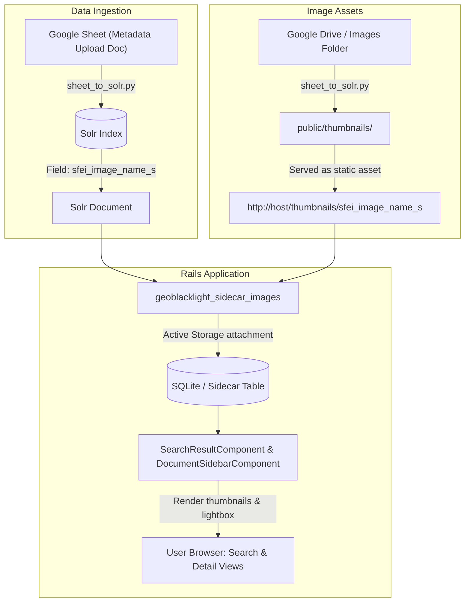

# Technical Specification & Plan: Geoblacklight Sidecar Images Integration
**Issue Reference:** [Issue #10: Install and Configure Geoblacklight Sidecar Images Plugin](https://github.com/noorsheikh2/SFEI-GeoBlacklight-Internal/issues/10)  
**Branch:** `10-geoblacklight-sidecar-images`  
**Date:** November 2026  
**Status:** In Review  

---

## 1. Overview & Goals
The goal of this enhancement is to install and configure the [`geoblacklight_sidecar_images`](https://github.com/geoblacklight/geoblacklight_sidecar_images) plugin into the SFEI GeoBlacklight internal application. This will display preview/thumbnail images alongside search result lists and on item show pages.

Key requirements:
1. Support image filenames provided in Solr documents ingested via an automated cron job.
2. Resolve image files reliably in all environments (development, CI, and containerized production).
3. Integrate `geoblacklight_sidecar_images` and Active Storage to cache and serve images.
4. Provide comprehensive documentation on adding images, Solr schema updates, and operational tasks.

---

## 2. Key Architecture & Design Assumptions

* **No GeoServer Generation Assumed:**  
  We assume SFEI does **not** want to use an external GeoServer WMS (`GetMap`) service to dynamically generate thumbnail images from raw vector/raster GIS layers. SFEI scientists and cartographers produce high-quality, publication-ready graphics, figures, and maps curated in Google Drive (`sfei_image_name_s`), which look significantly better than automated wireframe snapshots. GeoServer settings (`INSTITUTION_GEOSERVER_URL`, etc.) in `config/settings.yml` remain blank.
* **Follow-on Capability:** If SFEI ever decides in the future to auto-generate thumbnails from a live GeoServer instance, the application is already compatible: staff can populate `INSTITUTION_GEOSERVER_URL` and `INSTITUTION_LOCAL_NAME` in `config/settings.yml`, and the plugin's harvester will fall back to querying GeoServer WMS `GetMap` for any records without an explicit `sfei_image_name_s` value.
* **Search Result Thumbnail Sizing:**  
  We assumed a **120px × 120px** square thumbnail on search result cards (`object-fit: cover`, rounded with light border/shadow). For records lacking an attached image, a matching 120×120 neutral SVG map pin placeholder is displayed to preserve list alignment.
* **Detail (Show) Page Placement & Lightbox:**  
  We assumed:
  1. **Location:** In the right sidebar, positioned **below the tools/actions menu** so the image aligns horizontally with the main page title and description.
  2. **Dimensions:** Responsive sidebar width with `max-height: 250px` (`object-fit: contain`) to accommodate varying landscape/portrait aspect ratios without cropping.
  3. **Lightbox Modal:** Clicking the sidebar thumbnail opens a native Bootstrap 5 modal lightbox displaying the full-resolution graphic with a dark backdrop, allowing users to examine fine text, maps, and legends.

---

## 3. Open Questions for Team Alignment

Prior to merging and production rollout, review the following questions with the team:

1. **Search Results Thumbnail Dimensions:**
   * *Current Assumption:* 120px × 120px.
   * *Question:* Does the team prefer this 120px square size, or would a larger format (e.g. 150px) or smaller format (e.g. 100px) be preferred?
2. **Detail Page Placement:**
   * *Current State:* Both locations are currently rendered for direct side-by-side comparison:
     1. In the right sidebar below the tools menu.
     2. In the metadata attribute table directly under **Description** with the label **"Preview Image"**.
   * *Question for team:* Which location does the team prefer for the final version? (Sidebar only, metadata table only, or both?)
3. **Detail Page Lightbox vs. Direct Link:**
   * *Current Assumption:* Clicking the thumbnail opens a native Bootstrap modal lightbox displaying the full-resolution original image.
   * *Question:* Does the team prefer this lightbox modal, or should clicking open the image in a new browser tab?

---

## 4. Codebase & Environment Analysis

### 2.1 Solr Schema & Ingestion Discovery
* **Ingestion Script Found:** `sheet_to_solr.py`
  * Pulls from Google Sheet: `1Kv6W_hUBSz8dmYAqxvS_J_Y5UWXCgTYoaZSkK5WgYSs`
  * Generates Solr documents directly via Solr `/update` JSON API.
* **Exact Image Field Name in Solr:**  
  **`sfei_image_name_s`**
  * Example values found in live data:
    * `"BHM2020v13.png"`
    * `"lower_coyote_creek.png"`
    * `"ACCESS-CM2_historical_ssp245_climate_projections.png"`
* **Solr Dynamic Schema Support:**  
  `schema.xml` defines `<dynamicField name="*_s" type="string" stored="true" indexed="true"/>`.  
  Because `sfei_image_name_s` ends with `_s`, **no schema changes are needed in Solr**. It is already indexed and stored properly.

### 2.2 Image Storage & Ingestion Strategy (Google Drive Sync to Server Disk)
* **Image Source:**  
  Images reside in the SFEI Google Drive folder:  
  `https://drive.google.com/drive/folders/17D5TLgcpPV83MimUhCafa9roncOSgHsa`
* **Cron Sync to Server (`public/thumbnails/`):**
  * The automated ingestion job (`sheet_to_solr.py` / cron) will be enhanced with an image sync section that downloads referenced image files from Google Drive into the server's `public/thumbnails/` directory.
  * **File Caching & Immutability Rule:** Files that already exist in `public/thumbnails/` will **not** be re-copied/downloaded. If staff need to change or update an image, they must upload it with a new filename (e.g. `my_image_v2.png`) and update the filename in the Google Sheet. This new name is also required because `geoblacklight_sidecar_images` caches images permanently via Active Storage state tracking and will not re-fetch or serve a new file if it retains the same name.
  * **Images are NOT tracked in Git:** Image binaries remain excluded from git history (`.gitignore`), keeping the repository lightweight. A `.keep` file maintains the directory structure.
  * **Static asset serving:** Rails / reverse proxy serves the synced raw images directly at `http://<host>/thumbnails/<filename>` with zero proxy overhead.
* **Active Storage Architecture:**
  * **Storage Service:** Local Disk (`:local` service in `config/storage.yml`), storing processed attachments under `storage/`.
  * **Delivery Route:** Rails storage proxy mode (`config.active_storage.resolve_model_to_route = :rails_storage_proxy`) to stream images with long-term HTTP cache headers, avoiding 302 redirect roundtrips on search results.
  * **Container Persistence:** `/rails/storage` and `/rails/public/thumbnails` will be persisted via Docker volumes in production so synced files and sidecar caches survive container restarts.

---

## 5. Architecture & Data Flow



### 5.1 Field Mapping Flow
1. `sheet_to_solr.py` indexes each record into Solr with its image filename in **`sfei_image_name_s`** (e.g. `"BHM2020v13.png"`).
2. The application configuration points `GBLSI_THUMBNAIL_FIELD` to `sfei_image_name_s`.
3. Because the field contains a filename rather than a full URL, we configure the image harvester / URL helper to resolve filenames against `/thumbnails/` (e.g., `/thumbnails/#{document['sfei_image_name_s']}`).
4. `geoblacklight_sidecar_images` attaches the image to the `SolrDocumentSidecar` Active Record model.
5. In search results and show views, GeoBlacklight displays the sidecar image.

---

## 6. Step-by-Step Implementation Plan

### Phase 1: Environment & Branch Setup (Completed)
- [x] Create feature branch `10-geoblacklight-sidecar-images`.
- [x] Create `docs/specs/` directory and author this specification.

### Phase 2: Plugin & Storage Setup
- [x] Add `gem "geoblacklight_sidecar_images"` to `Gemfile`.
- [x] Run `bundle install`.
- [x] Run `bin/rails generate geoblacklight_sidecar_images:install --skip-views`.
  * *Generator Flag Note:* `--skip-views` is required because this application runs GeoBlacklight 5.4.0 with ViewComponents (`Geoblacklight::SearchResultComponent`) rather than legacy GBL 4 ERB split partials. The app uses Sprockets (`sprockets-rails`), so `--skip-assets` is omitted to retain the plugin's CSS/JS assets.
- [x] Review and run database migrations (`bin/rails db:migrate`).
- [x] Ensure Active Storage is configured in `config/storage.yml` (local disk storage for development and production) with proxy streaming mode in `config/application.rb`.

### Phase 3: Image Directory & Serving Configuration
- [x] Create repository directory `public/thumbnails/` with a `.keep` file, adding `public/thumbnails/*` (except `.keep`) to `.gitignore`.
- [x] Update `config/settings.yml` with:
  ```yaml
  GBLSI_THUMBNAIL_FIELD: 'sfei_image_name_s'
  ```
- [x] Configure `config/initializers/geoblacklight_sidecar_images.rb` to:
  * Check `public/thumbnails/<filename>` locally for instant, offline attachment.
  * Bridge `Geoblacklight::SolrDocument.find` to `::SolrDocument.find` for the pre-alpha gem job.
- [x] Implement custom `SearchResultComponent` (`app/components/search_result_component.rb` & `.html.erb`) subclassing `Geoblacklight::SearchResultComponent` to render `sidecar_thumbnail_tag` beside search results.
- [x] Update `CatalogController` with `config.index.document_component = SearchResultComponent` so Blacklight renders our custom component template instead of the gem's default.
- [x] Implement custom `DocumentSidebarComponent` (`app/components/document_sidebar_component.rb` & `.html.erb`) subclassing `Geoblacklight::Document::SidebarComponent` to display the thumbnail at the top of the sidebar on show pages.
- [x] Update `CatalogController` with `config.show.sidebar_component = DocumentSidebarComponent`.

### Phase 4: Harvesting & Ingestion Integration
- [x] Test the rake task `rake gblsci:images:harvest_all` on sample documents (11 succeeded, 0 failed, 3 placeheld).
- [x] Create `sheet_to_solr_with_images.py` supporting automated image caching and Google Drive sync.

### Phase 5: Testing & Verification
- [x] Verify image rendering on search result cards (thumbnails on left with fallback placeholder for unattached records).
- [x] Verify image rendering on document show pages (top of right sidebar).
- [ ] Add unit/model test for `SolrDocumentSidecar` and thumbnail URL resolution.
- [ ] Verify Docker build (`docker build .`) packages the `public/thumbnails/` directory.
- [ ] Run CI checks (`bin/brakeman`, `bin/rubocop`, `bin/rails test`).

### Phase 6: Operational Documentation
- [ ] Add `docs/IMAGE_MANAGEMENT.md` with instructions on:
  - How staff add new images to the Google Drive folder.
  - Image update policy: always use a new filename when changing/updating an image (existing files are not re-downloaded).
  - How the Google Sheet metadata corresponds to Solr (`sfei_image_name_s`).
  - How the sync and sidecar harvesting runs via cron.
  - Troubleshooting tips for missing images.
