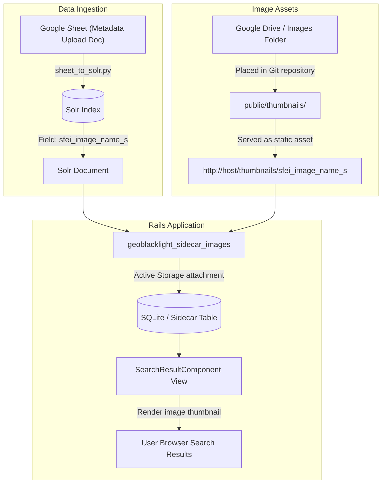

# Technical Specification & Plan: Geoblacklight Sidecar Images Integration
**Issue Reference:** [Issue #10: Install and Configure Geoblacklight Sidecar Images Plugin](https://github.com/noorsheikh2/SFEI-GeoBlacklight-Internal/issues/10)  
**Branch:** `10-geoblacklight-sidecar-images`  
**Date:** November 2026  
**Status:** Draft / In Review  

---

## 1. Overview & Goals
The goal of this enhancement is to install and configure the [`geoblacklight_sidecar_images`](https://github.com/geoblacklight/geoblacklight_sidecar_images) plugin into the SFEI GeoBlacklight internal application. This will display preview/thumbnail images alongside search result lists and on item show pages.

Key requirements:
1. Support image filenames provided in Solr documents ingested via an automated cron job.
2. Resolve image files reliably in all environments (development, CI, and containerized production).
3. Integrate `geoblacklight_sidecar_images` and Active Storage to cache and serve images.
4. Provide comprehensive documentation on adding images, Solr schema updates, and operational tasks.

---

## 2. Codebase & Environment Analysis

### 2.1 Solr Schema & Ingestion Discovery
* **Ingestion Script Found:** `sheet_to_solr.py`
  * Pulls from Google Sheet: `1Kv6W_hUBSz8dmYAqxvS_J_Y5UWXCgTYoaZSkK5WgYSs`
  * Generates Solr documents directly via Solr `/update` JSON API.
* **Exact Image Field Name in Solr:**  
  **`sfei_image_name_s`**
  * Example values found in live data:
    * `"BHM2020v13.png"`
    * `"lower_coyote_creek.png"`
    * `"ACCESS-CM2_historical_ssp245_climate_projections.png"`
* **Solr Dynamic Schema Support:**  
  `schema.xml` defines `<dynamicField name="*_s" type="string" stored="true" indexed="true"/>`.  
  Because `sfei_image_name_s` ends with `_s`, **no schema changes are needed in Solr**. It is already indexed and stored properly.

### 2.2 Image Storage & Deployment Analysis (Shared Drive vs. Git Repository)
* **The Shared Drive Issue:**  
  * The production application runs inside a Docker container (`Dockerfile`) with an unprivileged runtime user (`rails`, UID 1000).
  * Containers have isolated filesystems. External shared drives (e.g. network SMB shares or NAS) are **not accessible** to the running application unless explicitly mounted as Docker volumes on the production host and passed into the container at runtime.
  * In staging, CI (`.github/workflows/ci.yml`), or other developer machines, network drive paths will either not exist or lack authentication credentials, breaking tests and local preview.
* **The Git Repository Solution:**  
  * **Location:** `public/thumbnails/` (or `public/images/thumbnails/`).
  * **Why it works best:**
    1. **Self-contained deployment:** The Dockerfile executes `COPY . .`, automatically bundling `public/` into the container image.
    2. **Direct static serving:** Files in `public/thumbnails/<filename>` can be served directly by Rails or reverse proxies (Nginx, Traefik, Kamal proxy) with low overhead.
    3. **Reliability:** Every environment (local, CI test runner, production) has immediate access to the exact assets without network mount dependencies.
  * **Size considerations:** For thumbnail and preview imagery (typically 50–200 KB per image), thousands of images take only 50–150 MB, which is well within standard Git repository capabilities. (If image volumes grow to multi-gigabytes in the future, a cloud object store like S3/GCS or a mounted persistent volume can be introduced).

---

## 3. Architecture & Data Flow



### 3.1 Field Mapping Flow
1. `sheet_to_solr.py` indexes each record into Solr with its image filename in **`sfei_image_name_s`** (e.g. `"BHM2020v13.png"`).
2. The application configuration points `GBLSI_THUMBNAIL_FIELD` to `sfei_image_name_s`.
3. Because the field contains a filename rather than a full URL, we configure the image harvester / URL helper to resolve filenames against `/thumbnails/` (e.g., `/thumbnails/#{document['sfei_image_name_s']}`).
4. `geoblacklight_sidecar_images` attaches the image to the `SolrDocumentSidecar` Active Record model.
5. In search results and show views, GeoBlacklight displays the sidecar image.

---

## 4. Step-by-Step Implementation Plan

### Phase 1: Environment & Branch Setup (Completed)
- [x] Create feature branch `10-geoblacklight-sidecar-images`.
- [x] Create `docs/specs/` directory and author this specification.

### Phase 2: Plugin & Storage Setup
- [ ] Add `gem "geoblacklight_sidecar_images"` to `Gemfile`.
- [ ] Run `bundle install`.
- [ ] Run `bin/rails generate geoblacklight_sidecar_images:install`.
- [ ] Review and run database migrations (`bin/rails db:migrate`).
- [ ] Ensure Active Storage is configured in `config/storage.yml` (local disk storage for development and production).

### Phase 3: Image Directory & Serving Configuration
- [ ] Create repository directory `public/thumbnails/`.
- [ ] Add a `.keep` or sample thumbnail file to establish the folder.
- [ ] Update `config/settings.yml` with:
  ```yaml
  GBLSI_THUMBNAIL_FIELD: 'thumbnail_path_ss'
  ```
- [ ] Configure filename-to-URL normalization so that if Solr contains just `example.jpg`, the sidecar harvester knows to resolve it at `/thumbnails/example.jpg`.

### Phase 4: Harvesting & Ingestion Integration
- [ ] Test the rake task `rake gblsci:images:harvest_all` on sample documents.
- [ ] Provide a helper task or cron hook to trigger image harvesting automatically after Solr document indexing.

### Phase 5: Testing & Verification
- [ ] Add unit/model test for `SolrDocumentSidecar` and thumbnail URL resolution.
- [ ] Verify image rendering on search result cards and document show pages.
- [ ] Verify Docker build (`docker build .`) packages the `public/thumbnails/` directory.
- [ ] Run CI checks (`bin/brakeman`, `bin/rubocop`, `bin/rails test`).

### Phase 6: Operational Documentation
- [ ] Add `docs/IMAGE_MANAGEMENT.md` with instructions on:
  - How to add new images to `public/thumbnails/`.
  - How the Solr cron job should format image metadata.
  - How to run or schedule sidecar harvesting.
  - Troubleshooting tips for missing images.

---

## 5. Review & Open Questions for User
1. **Cron Field Name:** What exact field name is the cron job currently using to write the image filename into Solr? (If not yet chosen, we recommend `thumbnail_path_ss`).
2. **Image Format & Naming:** Are the images standard web formats (`.jpg`, `.png`, `.webp`) matching the identifier or a specific pattern?
3. **Approval to Proceed:** Does the above approach (committing images to `public/thumbnails/` and using `thumbnail_path_ss`) meet your requirements?
